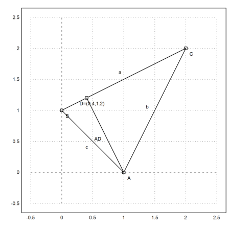
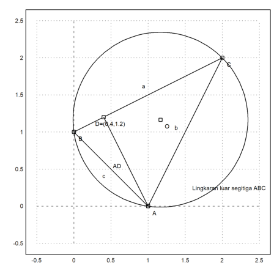
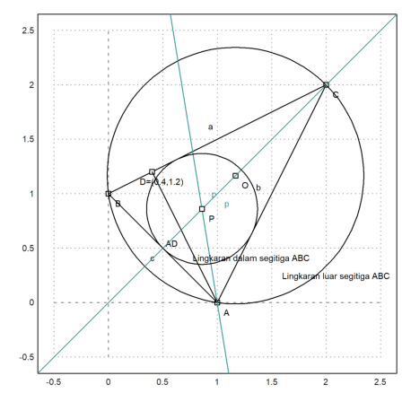
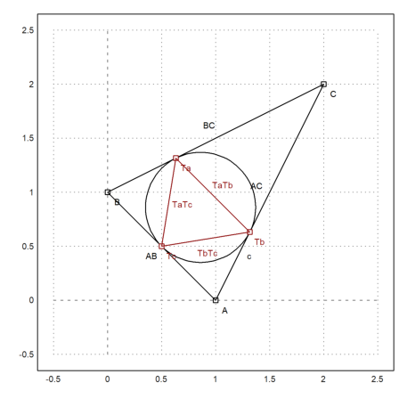
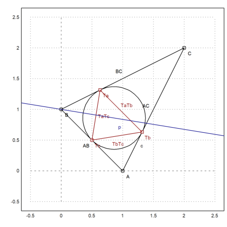
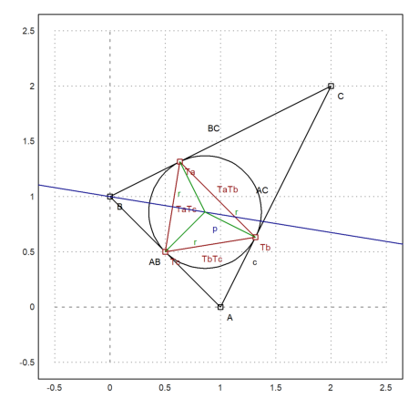

# Proyek Akhir Aplikasi Komputer — Euler Math Toolbox (EMT)

Repository ini berisi kumpulan dokumen tugas dan laporan praktikum mata kuliah **Aplikasi Komputer** menggunakan perangkat lunak **Euler Math Toolbox (EMT)**. Seluruh dokumen disusun secara terstruktur mencakup file notebook asli (`.en`), sumber dokumen (`.tex` / `.md`), aset gambar grafik (`images/`), serta laporan akhir berformat PDF (`.pdf`).

## Identitas Mahasiswa
* **Nama:** [Siti Maha Dana]
* **NIM:** [25030630011]
* **Kelas / Program Studi:** [E/ Matematika 2025]
* **Mata Kuliah:** Aplikasi Komputer

---

## Daftar Tugas & Laporan Praktikum

Klik pada tautan **PDF** di bawah ini untuk membuka laporan hasil akhir masing-masing materi:
| No | Materi / Topik | Laporan Akhir (PDF) | Notebook EMT (`.en`) | Dokumen Sumber (`.tex` / `.md`) |
| :-: | :--- | :--- | :--- | :--- |
| 1 | **Aljabar Lanjut & Latihan Soal** |[EMT4Geometry%20(4).pdf](EMT4Geometry%20(4).pdf)| [Aplikom3-4.en](Aplikom3-4.en) |[aplikom_3_4_latex.tex](aplikom_3_4_latex.tex) |
| 2 | **Kalkulus dengan EMT** |[EMT4Geometry%20(1).pdf](EMT4Geometry%20(1).pdf)| [EMT Kalkulus.en](EMT%20Kalkulus.en) |[emt_kalkulus_latex.tex](emt_kalkulus_latex.tex) |
| 3 | **Pengenalan & Langkah Awal EMT** |[EMT4Geometry%20(3).pdf](EMT4Geometry%20(3).pdf)|[EMT00-FisrtSteps.en](EMT00-FisrtSteps(1).en) |[emt_00_first_steps_latex.tex](emt_00_first_steps_latex.tex) |
| 4 | **Aljabar dengan EMT** |[EMT4Geometry%20(2).pdf](EMT4Geometry%20(2).pdf)| [EMT4aljabar.en](EMT4aljabar.en) |[emt_4_aljabar_latex.tex](emt_4_aljabar_latex.tex) |
| 5 | **Visualisasi & Grafik 2D** |[MT4Geometry%20.pdf](EMT4Geometry%20.pdf)| [EMT4Plot2D.en](EMT4Plot2D.en) |[emt_4_plot_2d_latex (1).tex](emt_4_plot_2d_latex%20(1).tex) |
| 6 | **Pendahuluan & Cara Kerja EMT** |[EMT4Geometry%20(5).pdf](EMT4Geometry%20(5).pdf)| [Aplikom 2.en](Aplikom%202.en) |[aplikom_2_latex.tex](aplikom_2_latex.tex) |
| 7 | **Geometri dengan EMT** | [EMT4Geometry%20(6).pdf](EMT4Geometry%20(6).pdf)| [EMT4Geometry.en](EMT4Geometry.en) |[EMT4Geometry.tex](EMT4Geometry.tex) |

---

## Daftar Aset Gambar Grafik

Berikut adalah kumpulan file gambar hasil render grafik dari Euler Math Toolbox (EMT):

### 1. Grafik Materi Kalkulus
*  — `EMT Kalkulus-001.png`
*  — `EMT Kalkulus-002.png`
*  — `EMT Kalkulus-003.png`
*  — `EMT Kalkulus-004.png`
*  — `EMT Kalkulus-005.png`
*  — `EMT Kalkulus-006.png`

### 2. Grafik Materi Geometri
*  — `EMT4Geometry-001.png`
*  — `EMT4Geometry-002.png`
*  — `EMT4Geometry-003.png`
*  — `EMT4Geometry-004.png`
*  — `EMT4Geometry-005.png`
*  — `EMT4Geometry-006.png`
